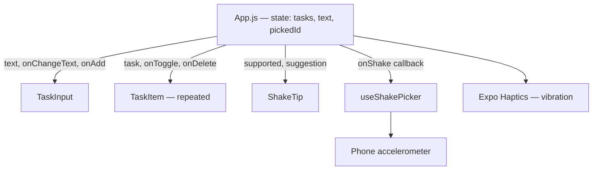

# ✅ Mobile To-Do — Code 401 Class 41 (Milestone 1 MVP)

**A beginner-friendly React Native + Expo app.** Inspired by the task list behavior in [Daymark / todo-app (main)](https://github.com/jtimm-gicw/todo-app/tree/main), but deliberately **not** a copy of the web application. The mobile project has no Express API, login, PostgreSQL, Vite, Mantine, or browser CSS.

## 🎯 Goal

In your **first React Native lab**, use the React skills you already know (components, props, `useState`, `.map()`, `.filter()`) to make an app run **on a real phone**. The assignment introduction mentions two phone features; the detailed minimum says one. **Our demo uses two** to satisfy both descriptions.

### What works in this MVP

- Add a task; mark it finished; delete a task.
- See the completed-task count.
- **Native feature #1 — Haptics:** the phone gives touch/vibration feedback when you toggle a task.
- **Native feature #2 — Accelerometer:** shake the phone to randomly highlight an unfinished task.
- Bright, readable mobile styling and accessibility labels.
- No internet API or database required once the app bundle has loaded.

**MVP limitation:** Tasks live in React state only, so restarting/reloading the app resets the demo list. This is intentional for Milestone 1. Some devices may not support haptics or motion detection; test on a physical phone. Motion does not work reliably in browser previews.

## 📁 Files

```text
mobile-todo-class41/
├── App.js                     # STEP 1–10: Parent screen; owns tasks and callbacks
├── components/
│   ├── TaskInput.js           # STEP 1–5: controlled form and Add button
│   ├── TaskItem.js            # STEP 1–5: one task, complete/delete actions
│   └── ShakeTip.js            # STEP 1–4: explains motion + shows chosen task
├── hooks/
│   └── useShakePicker.js      # STEP 1–6: motion sensor subscription
├── docs/
│   └── INSTRUCTOR_DEMO.md     # guided live teaching script
├── app.json                   # Expo display name and settings
├── package.json               # project scripts and packages
└── README.md                  # you are here
```

## 🗺️ UML — Component and data flow



**What UML means:** A diagram showing which parts of our application communicate. Data goes **down as props**; events call functions **back up in App**.

## 💻 Setup — first time

You need **Node.js LTS (22.13+ recommended)**, npm, a phone with **Expo Go** compatible with SDK 58, and a computer and phone connected to the same network (or use a tunnel).

### Option A: Use the ready-made project (recommended for the demo)

1. Download or clone this repository (after you publish it to GitHub).
2. In a terminal, go into its folder.
3. Install packages and check the setup:

```bash
npm install
npx expo install --check
npx expo-doctor@latest
```

4. Start Expo:

```bash
npx expo start
```

5. Open **Expo Go** on your Android phone and scan the QR shown in the terminal. On iPhone, scan using the Camera app / Expo Go as supported.
6. Add a task, tap to complete it, then gently shake the phone. Do not throw or drop the phone.

If phone and laptop cannot communicate because of the local network, try:

```bash
npx expo start --tunnel
```

Tunnel mode requires network access and may ask you to install a tunnel dependency or sign in. If the app shows an SDK mismatch, update Expo Go and run `npx expo install --fix` followed by `npx expo-doctor@latest`. **QR codes work only while the Expo development server is running and reachable**; sharing the GitHub URL does not itself make a live QR available to anyone at any time.

**PowerShell note:** If Windows blocks npm scripts, use `npm.cmd install`, `npx.cmd expo start`, or launch a suitable terminal.

### Option B: Build it with the class from a blank Expo app

Use a **blank JavaScript** Expo template (not the default Expo Router tabs template):

```bash
npx create-expo-app@latest mobile-todo-class41 --template blank
cd mobile-todo-class41
npx expo install expo-haptics expo-sensors
```

Then create the `components/` and `hooks/` folders, and copy the five source files (`App.js`, the three components, and the hook) from this repository. Run `npx expo start`. Expo sets compatible package versions for you when using `expo install`.

## 👩‍🏫 Step-by-step implementation plan

| Order | Open file | Student task | React web connection |
|---|---|---|---|
| 1 | `App.js` | Render a title with `Text` inside a `View`/`SafeAreaView` | `<h1>` inside a `<div>` |
| 2 | `components/TaskInput.js` | Add a `TextInput` and `Pressable` button | input + button |
| 3 | `App.js` | Set up `text` and `tasks` with `useState` | same hooks |
| 4 | `App.js` | Write `addTask`, `toggleTask`, `deleteTask` | spread/map/filter |
| 5 | `components/TaskItem.js` | Render one row, pass callback props | reusable React component |
| 6 | `App.js` | Use `tasks.map()` to show all tasks | same as web |
| 7 | `App.js` | Add `Haptics.selectionAsync()` | native phone feature #1 |
| 8 | `hooks/useShakePicker.js` | Listen for movement with `Accelerometer` | `useEffect` + event cleanup |
| 9 | `components/ShakeTip.js` | Display the highlighted task | conditional JSX |
| 10 | all files | Demonstrate on phone; practice styling | StyleSheet instead of CSS |

## 📱 How to use the app (end-user instructions)

1. Enter a task and press **Add**.
2. Tap the task to mark it completed. The phone may vibrate briefly.
3. Tap **Delete** to remove a task.
4. Shake your phone to highlight an unfinished task. The chosen task appears in a blue instruction panel and gets a yellow border.
5. Reloading the app restores the initial demonstration tasks.

## ✅ Class 41 / Milestone 1 checklist

- [x] React Native / Expo source files
- [x] Add / complete / delete task behavior
- [x] Native device feature: haptics
- [x] Second native device feature: accelerometer
- [x] README, component UML, instructions, comments
- [ ] Student confirms the app runs in Expo Go on **their own physical phone**
- [ ] Student shows a reachable QR code while Expo is running
- [ ] Student records screenshots / a short demonstration
- [ ] Student publishes a **new** GitHub repository with the README at the root
- [ ] Student presents a live demo and submits the README URL

**Milestone 2 idea:** Add persistent on-device task storage (`@react-native-async-storage/async-storage`) and extra UI polish. Do not add that during the first MVP demo unless students finish early.

## 🛠️ Troubleshooting

| Problem | Try |
|---|---|
| Expo QR loads but the phone cannot connect | Confirm same Wi-Fi; try `npx expo start --tunnel`; avoid blocked corporate networks |
| `expo` command not found | Use `npx expo start` (not global `expo`) after `npm install` |
| SDK version mismatch | Update Expo Go; run `npx expo install --fix`, then `npx expo-doctor@latest` |
| No vibration | Device may have haptics disabled or unsupported; logic still works |
| Shake doesn't work | Try a real phone; sensor may be missing or detection threshold not met |
| No database / no login | Correct for Milestone 1; not needed in this simplified app |

## 📚 Sources

- [React Native — Getting Started](https://reactnative.dev/docs/getting-started)
- [Expo — Create your project](https://docs.expo.dev/get-started/create-a-project/)
- [Expo Haptics](https://docs.expo.dev/versions/latest/sdk/haptics/)
- [Expo Accelerometer](https://docs.expo.dev/versions/latest/sdk/accelerometer/)
- [GitHub original web scaffold](https://github.com/jtimm-gicw/todo-app/tree/main)

## 🚀 Publish this as a NEW GitHub repository on `main`

1. On GitHub, select **New repository** and name it `js-401-class-41-mobile-todo` (or your course-code/lab-number format). Choose **Public**, and **do not** initialize it with a README because this folder already has one.
2. In the terminal, inside the downloaded `mobile-todo-class41` folder, run:

```bash
git init -b main
git add .
git commit -m "Class 41: React Native Expo MVP"
git remote add origin https://github.com/YOUR_USERNAME/js-401-class-41-mobile-todo.git
git push -u origin main
```

3. Replace `YOUR_USERNAME` with your GitHub username. Share `https://github.com/YOUR_USERNAME/js-401-class-41-mobile-todo/blob/main/README.md` for the lab.

**Do not** push to the original `todo-app` repository; this is a new and separate app.
