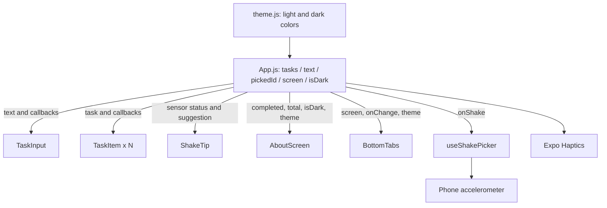

# ✅ Mobile To-Do — Code 401 Class 42: Polish & Delivery

A beginner-friendly **React Native + Expo** app, based on the task-management ideas in [Daymark todo-app (`main`)](https://github.com/jtimm-gicw/todo-app/tree/main). This is a separate mobile project with no backend, database, login, or navigation library.

## 👩‍🎓 What the app does

- **Tasks screen:** Add tasks, check them off, delete them, view completion progress.
- **About & Demo screen:** See the same progress, check the current theme, and read end-user instructions.
- **Light / dark mode:** Tap the top-right theme button; both screens update.
- **Phone feature #1 — Haptics:** Tapping a task gives physical feedback (if supported).
- **Phone feature #2 — Accelerometer:** Gently shake the phone to choose an unfinished task (if supported).
- Thumb-friendly bottom tabs, large buttons, strong color contrast, and accessibility labels.

**Learning goal:** Use existing React knowledge (`useState`, props, `.map()`, `.filter()`, conditional rendering) to build a mobile experience with native components and JavaScript-based `StyleSheet` styling (CSS-in-JS).

**Important limitation:** Tasks and theme are stored in memory only and reset after a reload. Saving data permanently is a possible future exercise, not required for these milestones.

## ✅ Class 42 rubric

| Requirement | Where it is demonstrated |
|---|---|
| Two screens/components | `Tasks` in `App.js`, `About & Demo` in `AboutScreen.js` (and several reusable components) |
| State shared between screens | `App.js` owns tasks, theme and screen state; `AboutScreen` receives `completed`, `total`, `isDark` props |
| Native device feature | `expo-haptics` and `expo-sensors` (accelerometer) |
| Thoughtful CSS-in-JS styling | `StyleSheet.create()` plus `theme.js` colors |
| Right-sized tap targets, contrast | Most controls 52–62 points high, clear text on light/dark palettes |
| Dark/light modes | Toggle in `App.js`; shared theme prop updates both screens |
| Left/right thumb usability | Full-width Add button, bottom tabs, generous task controls |
| End-user documentation | “How to use” below and About & Demo screen |
| Live demo | 3-minute script below; test on a real phone |

## 🗺️ UML — Component relationships and shared state



**UML:** A picture of the app's parts and how they share information. The parent `App.js` stores state and sends values and callback functions down to child components as props.

## 📂 File guide

```text
todo-mobile-app-class42/
├── App.js                     Main app, task state, screen & theme toggle
├── theme.js                   Light and dark color palettes
├── components/
│   ├── TaskInput.js           Controlled input, Add button
│   ├── TaskItem.js            Complete and Delete controls
│   ├── ShakeTip.js            Motion instructions and selected task
│   ├── AboutScreen.js         Second screen, shared state example
│   └── BottomTabs.js          Two thumb-friendly navigation buttons
├── hooks/
│   └── useShakePicker.js      Motion listener, cleanup, shake cooldown
├── docs/
│   └── CLASS42_INSTRUCTOR_GUIDE.md
├── app.json                   Expo project settings
├── package.json               Package list and start commands
└── README.md
```

Each source component is documented with **`STEP #` teaching comments**. The existing Class 41 add/complete/delete logic and phone features remain familiar.

## 💻 PowerShell: upgrade your existing `todo-mobile-app`

**Back up your working Class 41 project first.** This ZIP is an updated replacement project, not an automatic patch. You can either extract it into a new folder (safest) or replace the code files in your existing folder. Don't overwrite any locally customized work without saving it first.

### Safest method — run the new folder

1. Download and extract `todo-mobile-app-class42.zip` into `Downloads`.
2. In PowerShell:

```powershell
cd "$HOME\Downloads\todo-mobile-app-class42"
npm.cmd install
npx.cmd expo install --check
npx.cmd expo start --tunnel
```

3. Open **Expo Go** on your Android phone and scan the QR code. Use tunnel mode because it worked for the Class 41 project on your network.
4. If a dependency mismatch is reported, run `npx.cmd expo install --fix`, then try `npx.cmd expo start --tunnel --clear`.

### Replace your current project instead

Copy **`App.js`, `theme.js`, `components/`, `hooks/`, `app.json`, `README.md`, and `docs/`** from the new folder into your existing `todo-mobile-app` folder. Keep your existing `.git` folder. Use the updated `package.json` only after checking for any dependencies you personally added. Then:

```powershell
cd "$HOME\Downloads\todo-mobile-app"
npm.cmd install
npx.cmd expo start --tunnel --clear
```

If your existing project lives elsewhere, change the `cd` path. You do **not** need PostgreSQL, a backend, Android Studio or an emulator. A physical Android phone with compatible Expo Go is enough.

## 📱 Instructions for end users

1. On **Tasks**, type a new task, then tap **+ Add**.
2. Tap the checkbox or task text to mark it done. A supported phone will produce a small vibration.
3. Tap **Delete** to remove a task.
4. Gently shake the phone to highlight a randomly selected unfinished task.
5. Tap **☾ Dark** / **☀ Light** in the header to switch appearance.
6. Tap **About & Demo** to read instructions and see the same completion count. Tap **Tasks** to return.
7. Keep Expo running on the developer's computer while testing through the QR code.

## 🎤 Three-minute classroom presentation

- **0:00–0:30 — Goal:** Explain that the project is a mobile version of a basic React task list.
- **0:30–1:15 — Core functionality:** Add, complete, and delete a task; show the progress bar.
- **1:15–1:45 — Native features:** Tap a task to feel haptics; gently shake to highlight one task.
- **1:45–2:15 — UX polish:** Switch dark/light mode and show readable, large touch targets.
- **2:15–2:45 — Shared state:** Switch to About; note the same task count and theme.
- **2:45–3:00 — Reflection:** Explain one thing you learned about React Native vs web React.

## 🧪 Demo checklist

- [ ] Expo opens on physical phone through `npx.cmd expo start --tunnel`
- [ ] Add, complete, and delete tasks
- [ ] Progress number and bar update
- [ ] About & Demo shows the same progress
- [ ] Light and dark modes both have readable text
- [ ] Bottom tabs and Add / Delete controls are easy to tap
- [ ] Haptics and shake selection tested (subject to device support)
- [ ] QR code works while the development server is running
- [ ] README exists at repo root and GitHub changes are committed

## 🔧 Common issues

| Issue | Solution |
|---|---|
| PowerShell blocks `npm` or `npx` | Use `npm.cmd` and `npx.cmd` |
| Phone can't connect to regular QR | Use `npx.cmd expo start --tunnel` |
| Old code appears | Stop server, run `npx.cmd expo start --tunnel --clear` |
| No vibration | Device haptic capability/settings vary |
| Shake not detected | Use a real phone and gently but clearly shake; sensor may be unsupported |
| Tasks reset after reload | Expected: React state is not persistent storage |
| QR code works only while laptop is running | Expected for an Expo development server; not a published store app |

## GitHub submission

Use your **separate mobile repository**, not the original `jtimm-gicw/todo-app` web repository. After testing:

```powershell
git status
git add .
git commit -m "Class 42: add dark mode, second screen and mobile polish"
git push origin main
```

If you have not connected a remote repository yet, create one on GitHub and add its URL with `git remote add origin YOUR_REPO_URL` before pushing. Submit the URL to **`README.md` on `main`**.

## Resources

- [React Native documentation](https://reactnative.dev/docs/getting-started)
- [Expo documentation](https://docs.expo.dev/)
- [Expo Haptics](https://docs.expo.dev/versions/latest/sdk/haptics/)
- [Expo Accelerometer](https://docs.expo.dev/versions/latest/sdk/accelerometer/)
